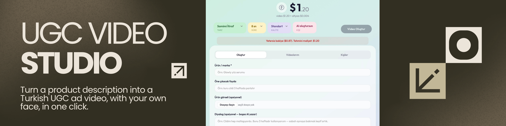
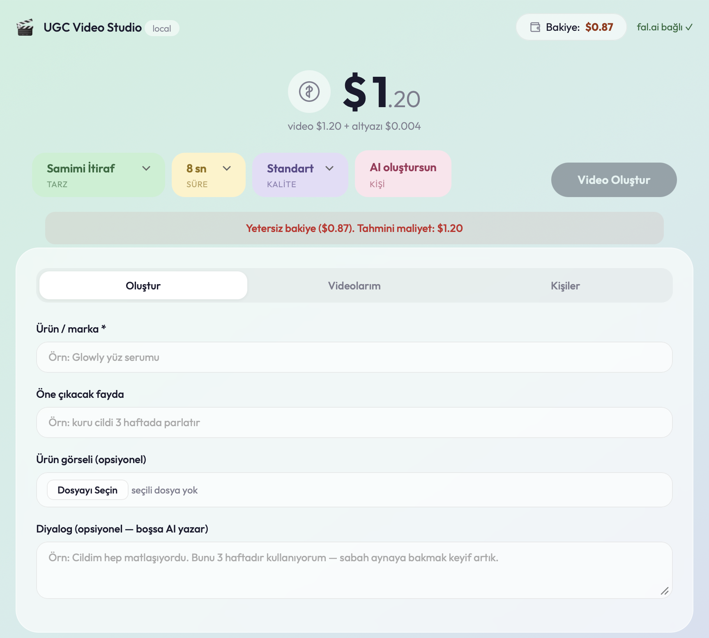
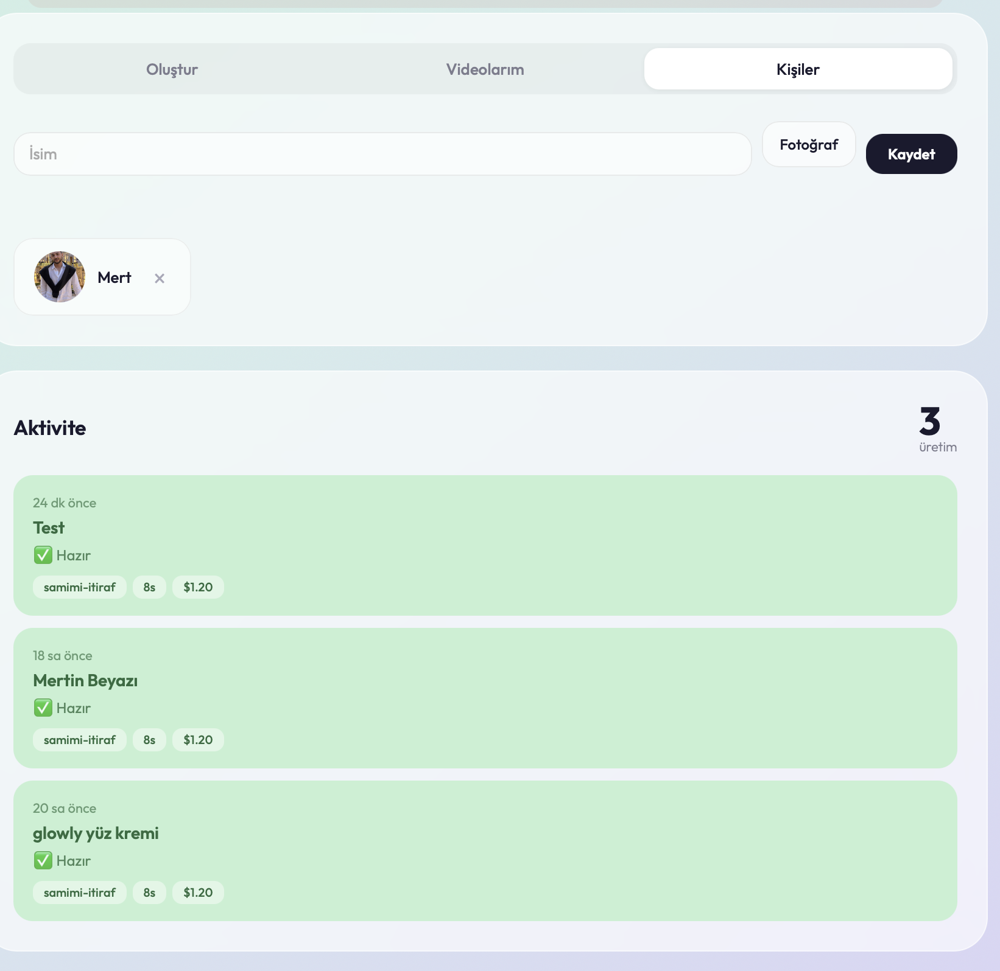

# UGC Video Studio

**Turn a product description into a sales-ready UGC ad video with Turkish voiceover and subtitles.**
One click. Your own face. Claude Code + fal.ai.

---

## What does it do?

Write a sentence in Turkish, get a professional UGC video back:

- **Automatically picks the right model** based on scene type (Veo 3.1 / Seedance 2.0)
- **Turkish voiceover** and **professional subtitles** added in a separate pipeline
- 8 UGC styles: Sincere Confession, Excited Discovery, Problem-Solution, Street Interview, Luxury/Aesthetic, Comedy/Fun, Expert Advice, Before-After
- Upload your own face, **persona + product** auto-composited
- **Visual approval flow**: preview the scene as an image first, convert to video once approved
- **Cost confirmation** before every generation — no surprise charges

> 8-second Turkish voiced video ~ **$1.20** (pay-as-you-go, no subscription)

---

## How does it work?

```
You (write in Turkish)  -->  Claude Code + Skill  -->  fal.ai (produce video)  -->  Video link
```

Three components:
1. **Claude Code** — AI assistant you run from the terminal
2. **fal.ai** — the service that actually produces the video (connected via MCP bridge)
3. **Skill package** — instruction system that tells Claude "produce UGC videos following these rules"

---

## Quick start

### 1. Prerequisites

- [Node.js](https://nodejs.org) v18+
- [Claude Code](https://docs.anthropic.com/en/docs/claude-code) installed
- [fal.ai](https://fal.ai) account + API key

### 2. Install the skills

Download or clone this entire repo. Skills inside `.claude/skills/` are loaded automatically.

```
.claude/skills/
  ugc-video-studio/     <-- main skill (video production)
  mini-app-builder/     <-- local dashboard builder
```

### 3. Connect fal.ai MCP (one-time setup)

```bash
claude mcp add --scope user --transport http fal-ai \
  https://mcp.fal.ai/mcp \
  --header "Authorization: Bearer YOUR_API_KEY"
```

### 4. Produce your first video

```bash
cd /path/to/this-folder
claude
```

Type in Claude Code:

```
UGC video studio skill'ini kullan. Dogal cilt bakim serumu tanitan
bir UGC videosu uret. Genc bir kadin, banyoda, samimi tonda Turkce
konussun. TikTok formati, altyazili.
```

> Detailed step-by-step setup: [`dokumanlar/KURULUM-KILAVUZU.md`](dokumanlar/KURULUM-KILAVUZU.md)

---

## Local dashboard (Mini App)

To use from a browser instead of chat:

```
Mini app'e donustur.
```

Claude Code sets up the `mini-app/` folder. Then:

```bash
cd mini-app
cp .env.example .env   # paste your API key
npm install && npm start
```

`http://localhost:3000` — same 8 styles, quality selection, image upload, live cost estimate, auto-subtitles.

| Dashboard | Personas + Activity |
|-----------|-----------------|
|  |  |

### Mini app features

- **Form**: brand/product, style dropdown, duration, quality level, image upload, dialog
- **Live cost estimate** — updates as you change the form
- **Persona system** — upload your face, reuse across videos
- **Image compositing** — persona + product image auto-composed
- **Production list** — status tracking, video player, download
- **Auto-subtitles** — Turkish subtitles added in the background after each video completes
- **Error handling** — 422 (prompt rejection) and 500 (MCP/fal) errors shown clearly to the user

---

## Project structure

```
.
├── .claude/skills/
│   ├── ugc-video-studio/          # Main skill — video production via chat
│   │   ├── SKILL.md
│   │   └── references/
│   │       ├── ugc-tarzlari.md        # 8 UGC styles + prompt skeletons
│   │       ├── prompt-rehberi.md      # Rich prompt generation rules
│   │       └── model-ve-maliyet.md    # Model pool + costs + error behaviors
│   └── mini-app-builder/          # Second skill — sets up the local dashboard
│       ├── SKILL.md
│       └── templates/                 # Express + HTML templates
├── mini-app/                      # Built local dashboard
│   ├── server.js                      # Express + fal.ai REST proxy
│   ├── public/                        # Frontend (vanilla HTML/CSS/JS)
│   └── data/                          # Runtime job storage (JSON)
├── dokumanlar/
│   ├── KURULUM-KILAVUZU.md        # Zero-to-hero setup (for non-terminal users)
│   ├── ORNEK-PROMPTLAR.md         # Copy-paste ready prompt cards
│   └── APP-YOL-HARITASI.md       # Monetization / SaaS roadmap
├── docs/                          # Banner and screenshots
└── BURADAN-BASLA.md               # Training package guide
```

---

## Model pool

Free model browsing is **prohibited** — a fixed pool is used for consistency:

| Model | Usage | Max duration | ~ Cost |
|-------|-------|-------------|--------|
| **Veo 3.1 Fast** | Default, fast production | 8 sec | $1.20 / 8s |
| **Veo 3.1 Lite** | Budget / testing | 8 sec | $0.40 / 8s |
| **Veo 3.1** | Premium quality | 8 sec | $3.20 / 8s |
| **Seedance 2.0 Fast** | Long video (9-15 sec) | 15 sec | ~$1.10 / 12s |
| **auto-subtitle** | Turkish subtitle overlay | — | ~$0.03/min |

---

## Production pipeline

```
1. Collect brief (product, style, duration)
          |
2. Select model (automatic via decision tree)
          |
3. Build rich prompt (15-25 line English scene + Turkish dialog)
          |
4. Show cost estimate, get approval
          |
5. Stage A — Generate video (clean, no subtitles)
          |
6. Stage B — Add subtitles (separate model, Turkish)
          |
7. Deliver + suggest improvements
```

---

## Example prompts

**Simplest:**
```
UGC video studio skill'ini kullan. [URUN] icin bir UGC reklam videosu uret. Sen karar ver.
```

**With style:**
```
UGC video studio skill'ini kullan. [URUN] icin "Problem-Cozum" tarzinda,
dikey, Turkce sesli, altyazili bir UGC videosu uret.
```

**Visual approval flow:**
```
UGC video studio skill'ini kullan. [URUN] icin bir UGC videosu istiyorum
ama once sahneyi gorsel olarak goreyim, onaylayinca videoya cevir.
```

**A/B testing:**
```
UGC video studio skill'ini kullan. [URUN] icin 3 farkli kancayla
3 ayri kisa UGC videosu uret. Toplam maliyeti tek seferde soyle.
```

> All examples: [`dokumanlar/ORNEK-PROMPTLAR.md`](dokumanlar/ORNEK-PROMPTLAR.md)

---

## Monetization roadmap

| Level | What | Development |
|-------|------|-------------|
| **1 — Service** | You produce, deliver to client | Zero code, start today |
| **1.5 — Mini App** | Speed up operations with local dashboard | Just say `mini app'e donustur` |
| **2 — Semi-automated** | Client fills order form, you produce | Simple web form |
| **3 — Full SaaS** | Client self-serves, you stay hands-off | Full-stack application |

Your cost: **~$1.20/video**. Traditional UGC market rate: **$100-500/video**. The margin is yours.

> Details: [`dokumanlar/APP-YOL-HARITASI.md`](dokumanlar/APP-YOL-HARITASI.md)

---

## Security

- API key **stays on your machine**, read from `.env`
- Never commit your key to GitHub, screenshots, or shared files
- Set a spending limit/alert on your fal.ai account
- Do not generate content featuring copyrighted brands, celebrities, or characters

---

## License

This package is for educational purposes. Check fal.ai and related model terms of service for commercial use.
