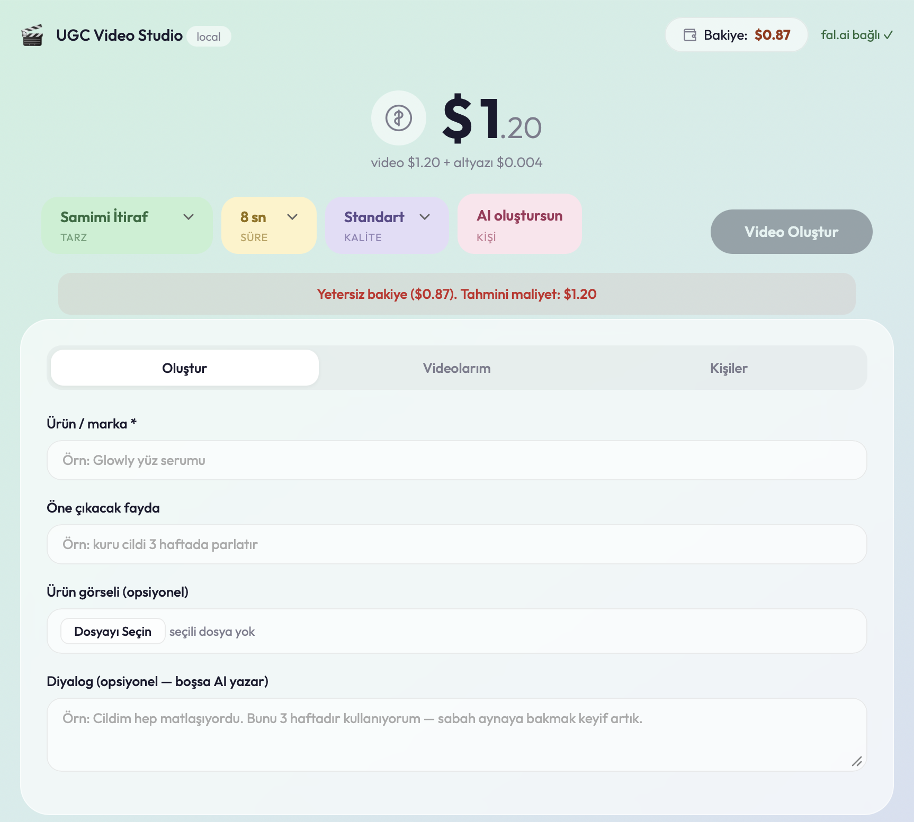

<p align="center">
  
</p>

<p align="center">
  <b>UGC Video Studio turns a product description into a Turkish UGC ad video.</b> Pick a style, duration and quality, add a product image and an optional face, and a local dashboard produces the video and adds subtitles.
</p>

<p align="center">
  
  
  
  
  
</p>

---

## Features

- **8 UGC styles** — Sincere Confession, Excited Discovery, Problem-Solution, Street Interview, Luxury/Aesthetic, Comedy/Fun, Expert Advice and Before-After.
- **Quality tiers** — Economy, Standard and Premium use Veo 3.1 (Lite, Fast, full) for 4 to 8 second clips. A Long tier uses Seedance 2.0 Fast for clips up to 15 seconds.
- **Product image plus persona** — Upload a product image and a saved face; they are composed into one starting frame before the video is generated.
- **Auto-subtitles** — Turkish subtitles are added in a separate step after the clean video is ready.
- **Live cost estimate** — The price updates as you change the form, and the fal.ai balance can be shown in the header.
- **Video library** — Every job is listed with its status, a player and a download link.

## Screenshots

<p align="center">
  
</p>

## How It Works

You fill in the product, the benefit to highlight, an optional product image and an optional dialog (left empty, the AI writes one), then choose the style, duration, quality and persona. The Express server checks the cost, composes the product image with the persona when both are given, and sends the job to fal.ai, where the selected video model generates the clip. When the clean video is ready, a second model adds Turkish subtitles. The dashboard polls the job, shows the result in the video library, and keeps jobs and personas as local JSON files. This repository contains the local dashboard only; the Claude Code skill I use to produce videos from chat is not included.

## Setup

```bash
git clone https://github.com/emirhanoktay/ugc-video-studio.git
cd ugc-video-studio/mini-app
cp .env.example .env   # paste your fal.ai API key as FAL_KEY
npm install
npm start
```

Open http://localhost:3000. You need Node.js 18+ and a [fal.ai](https://fal.ai) account. `FAL_ADMIN_KEY` is optional and only enables the balance display. Videos cost money on fal.ai; the estimate in the header shows the price before you generate (an 8-second Standard video is about $1.20).

## Contact

<p align="center">
  <a href="https://www.linkedin.com/in/emirhanoktay"></a>
  <a href="https://instagram.com/emirhannoktayy"></a>
  <a href="mailto:emirhanoktayy1@gmail.com"></a>
</p>
